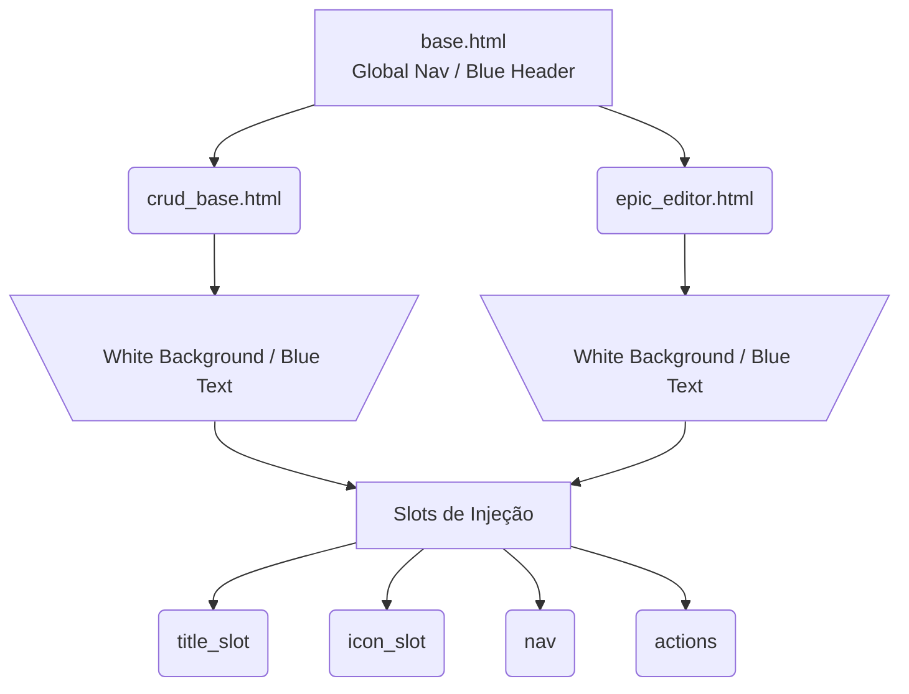

## Overview

OG1 Tecnologia's corporate site uses a dual-typeface system (sans-serif + serif) with an ultra-light weight (w200) for large display text and regular weight for body copy. The brand's signature OG1 Blue (#0b41cd) drives all interactive elements: primary buttons, links, and focus states, against predominantly white and warm-grey surfaces. Hero sections feature a distinctive warm-to-cool gradient wash (peach/salmon to light blue) defined via CSS custom properties. The overall aesthetic is open, human, professional and authoritative with generous whitespace, a single 6px border-radius token, and subtle drop shadows for elevation.

**Signature traits:**

- Dual typeface system: Pairs sans-serif and serif across the type hierarchy.
- Tight geometric corners: Near-square geometry with corner radii capped around 6px.
- Layered elevation: Depth comes from 4 validated shadow tokens.

## Colors

The palette uses 8 validated color tokens across 1 theme profile. Semantic roles stay attached to observed usage so generation agents can choose accents without inventing new color meaning.

**Semantic naming:**

- **action-border** maps to `og1-blue`: Role "border" is grounded by usage context "Primary buttons, links, interactive states, logo outline, focus rings".
- **content-text** maps to `pure-black`: Role "text" is grounded by usage context "Primary body text, headings, nav labels".
- **action-background** maps to `white`: Role "background" is grounded by usage context "Page background, card surfaces, button text on primary CTA, dropdown backgrounds".
- **border-border** maps to `og1-grey-300`: Role "border" is grounded by usage context "Dividers, hairlines, subtle borders".

### Text Scale

- **Error Red** (#ff1f26): Error states, status indicators, alert badges. Role: text. {authored: rgb(255, 31, 38), space: rgb}
- **Grey 900** (#21201f): Footer text, deep dark labels. Role: text. {authored: rgb(33, 32, 31), space: rgb}
- **Pure Black** (#000000): Primary body text, headings, nav labels. Role: text. {authored: rgb(0, 0, 0), space: rgb}
- **OG1 Grey 700** (#544f4f): Secondary text, nav items, subheadings, footer text. Role: text. {authored: rgb(84, 79, 79), space: rgb}

### Interactive

- **Grey 500** (#9d948e): Muted borders, placeholder text, secondary UI chrome. Role: border. {authored: rgb(157, 148, 142), space: rgb}
- **OG1 Blue** (#0b41cd): Primary buttons, links, interactive states, logo outline, focus rings. Role: border. {authored: rgb(11, 65, 205), space: rgb}
- **OG1 Grey 300** (#dbd6d1): Dividers, hairlines, subtle borders. Role: border. {authored: rgb(219, 214, 209), space: rgb}

### Surface & Shadows

- **White** (#ffffff): Page background, card surfaces, button text on primary CTA, dropdown backgrounds. Role: background. {authored: rgb(255, 255, 255), space: rgb}

## Typography

Typography uses sans-serif, serif across extracted hierarchy roles. Keep hierarchy mapped to these token rows before adding decorative type styles.

Mixes sans-serif and serif for visual contrast. Weight range spans light, regular. Sizes range from 14px to 48px.

### Font Roles

- **Headline Font**: sans-serif
- **Body Font**: sans-serif

### Type Scale Evidence

| Role                                                                    | Font        | Size | Weight | Line Height | Letter Spacing | Stack / Features | Notes           |
| ----------------------------------------------------------------------- | ----------- | ---- | ------ | ----------- | -------------- | ---------------- | --------------- |
| Largest hero headline, ultra-light weight for brand impact              | sans-serif  | 48px | 200    | 54px        | normal         | sans-serif       | Extracted token |
| Section headings, page-level H2 (confirmed via probe: h2.headline 40px) | sans-serif  | 40px | 200    | 48px        | normal         | sans-serif       | Extracted token |
| Sub-section headings, card titles                                       | sans-serif  | 30px | 400    | 39px        | normal         | sans-serif       | Extracted token |
| Card headings, feature titles                                           | sans-serif  | 24px | 400    | 34px        | normal         | sans-serif       | Extracted token |
| Primary body copy, most frequent text style across the page             | sans-serif  | 20px | 200    | 32px        | normal         | sans-serif       | Extracted token |
| Standard body text, nav items, button labels (confirmed via probe)      | sans-serif  | 18px | 400    | 29px        | normal         | sans-serif       | Extracted token |
| Captions, labels, secondary UI text                                     | sans-serif  | 16px | 400    | 20px        | normal         | sans-serif       | Extracted token |
| Small labels, footnotes, metadata                                       | sans-serif  | 14px | 400    | 19px        | normal         | sans-serif       | Extracted token |
| Pull quotes, editorial callouts, story highlights                       | serif | 28px | 200    | 40px        | normal         | serif      | Extracted token |

## Component Architecture

A interface do sistema adota uma estrutura de componentes em camadas (usando `django-cotton`), projetada para manter consistência sem perda de flexibilidade.

### Hierarquia de Cabeçalhos
Temos dois níveis principais de cabeçalhos na aplicação:
1. **Global Header (base.html)**: Cabeçalho fixo, global (azul), que contém a identidade visual da empresa, navegação principal superior e profile do usuário logado.
2. **Secondary Module Header (`<c-module-header>`)**: Cabeçalho de contexto introduzido no topo das páginas internas (como *Epic Editor* e *CRUD Base*). Possui fundo branco (`bg-white`), texto em azul (`text-og1-blue`), uma borda inferior (`border-b border-gray-200`) e sombra leve. Define a área de trabalho atual e provê acesso rápido a abas, ações ou filtros locais.

## Layout

Responsive system uses 4 breakpoint tier(s): mobile, tablet, desktop, wide.

This system uses a 4px base grid with scale values 4, 8, 12, 16, 24, 32, 40, 48, 64.

### Responsive Strategy

- **mobile (348-1023px)**: Constrain layout for small viewports and prioritize vertical stacking.
- **tablet (768-1023px)**: Increase spacing and column structure for medium-width viewports.
- **desktop (1024-1407px)**: Expand layout density and horizontal composition for wide viewports.
- **wide (>= 1480px)**: Stretch composition with generous gutters and wider layout spans.

### Spacing System

| Token     | Value | Px  | Notes                   |
| --------- | ----- | --- | ----------------------- |
| spacing-1 | 4px   | 4   | Extracted spacing token |
| spacing-2 | 8px   | 8   | Extracted spacing token |
| spacing-3 | 12px  | 12  | Extracted spacing token |
| spacing-4 | 16px  | 16  | Extracted spacing token |
| spacing-5 | 24px  | 24  | Extracted spacing token |
| spacing-6 | 32px  | 32  | Extracted spacing token |
| spacing-7 | 40px  | 40  | Extracted spacing token |
| spacing-8 | 48px  | 48  | Extracted spacing token |
| spacing-9 | 64px  | 64  | Extracted spacing token |

## Elevation & Depth

Keep depth flat unless validated shadow or interaction evidence appears in the extraction payload. Do not invent shadows beyond this evidence boundary.

### Shadow Evidence

| Shadow Token        | Layers | Details                                   |
| ------------------- | ------ | ----------------------------------------- |
| dropdown-shadow     | 1      | 0px 4px 12px 0px rgba(0, 0, 0, 0.1)       |
| card-shadow         | 2      | 0px 2px 4px 0px rgba(0, 0, 0, 0.11)       |
| inset-border-shadow | 1      | inset 0px -1px 0px 0px rgb(219, 214, 209) |
| ambient-shadow      | 1      | 0px 0px 10px 0px rgba(0, 0, 0, 0.1)       |

### Interaction Signals

| Theme | Signal         | Evidence                                                                             |
| ----- | -------------- | ------------------------------------------------------------------------------------ |
| Light | outline-color  | rgb(0, 0, 0) ; rgb(84, 79, 79) ; rgb(11, 65, 205)                                    |
| Light | outline-width  | 3px                                                                                  |
| Light | outline-offset | 0px                                                                                  |
| Light | transform      | matrix(1, 0, 0, 1, 0, 0) ; matrix(1, 0, 0, 1, -16, 41) ; matrix(1, 0, 0, 1, 0, -800) |

## Shapes

Shape language maps directly to rounded tokens. Keep component corners consistent with the role mapping below before introducing bespoke geometry.

### Radius Roles

| Token     | Value | Px  | Role Mapping  |
| --------- | ----- | --- | ------------- |
| radius-sm | 6px   | 6   | Subtle corner |

### Geometry Evidence

| Radius Token | Shape | Units |
| ------------ | ----- | ----- |
| radius-sm    | 6px   | px    |

## Components

Components should be recreated from token references first, then tuned with variant notes and probe-backed state guidance.

- **Primary CTA Button**: Solid filled button using OG1 Blue background with white text. No border-radius (0px), generous padding. Used for primary actions like 'Read our story'.
- **Primary Navigation**: Top-level horizontal navigation with two tiers: utility nav (Stories, Careers, Contact) and main nav (About OG1 Tecnologia, Solutions, Innovation, Investors, Media). Items use sans-serif 18px.
- **Dropdown Submenu**: Full-width dropdown panel that appears on nav item hover. White background with soft drop shadow, 24px 16px padding. Contains columnar link groups.
- **Hero Section**: Full-width hero with a warm-to-cool gradient background (peach/salmon to light blue), large display heading in sans-serif w200, subtext, and two CTA buttons. Right side features a lifestyle photography panel.
- **Section Heading**: H2-level section headings using sans-serif ultra-light weight at 40px. Black text on transparent background.
- **Media Center Link**: Outlined rectangular link button with blue text and blue border, used for section-level navigation like 'Visit Media center →'.

### Button

**Primary Filled**

- backgroundColor: #0b41cd
- textColor: #ffffff
- rounded: 0px
- padding: 16px 24px
- fontSize: 18px
- fontWeight: 400
- borderWidth: 0px
- boxShadow: none
- State guidance: Probe-confirmed: a.button — backgroundColor rgb(11,65,205), color rgb(255,255,255), padding 16px 24px, borderRadius 0px

**Secondary Outline**

- backgroundColor: transparent
- textColor: #0b41cd
- rounded: 0px
- padding: 16px 24px
- fontSize: 18px
- fontWeight: 400
- borderWidth: 1px
- borderColor: #0b41cd
- State guidance: Visually confirmed in screenshot: 'About OG1 Tecnologia' ghost button with blue border and blue text

### CTA Link Button

**Outlined Link**

- textColor: #0b41cd
- borderColor: #0b41cd
- borderWidth: 1px
- backgroundColor: transparent
- rounded: 0px
- padding: 16px 24px
- fontSize: 18px
- State guidance: Visually confirmed in screenshot bottom-right; matches secondary button pattern

### Heading

**H2 Headline**

- textColor: #000000
- fontSize: 40px
- fontWeight: 200
- lineHeight: 48px
- backgroundColor: transparent
- rounded: 0px
- padding: 0px
- State guidance: Probe-confirmed: h2.headline — color rgb(0,0,0), fontSize 40px

### Hero

**Gradient Hero**

- backgroundColor: linear-gradient(136.47deg, #fff 35.41%, #fff7f5 58%, #bde3ff 128.14%)
- headingFontSize: 40px
- headingFontWeight: 200
- headingColor: #000000
- bodyFontSize: 20px
- bodyFontWeight: 200
- State guidance: CSS variable --background-aware-gradient-bottom-right confirmed; heading confirmed via probe h2.headline 40px w200

### Navigation Bar

**Nav Item**

- textColor: #544f4f
- backgroundColor: transparent
- rounded: 6px
- padding: 4px 12px
- fontSize: 18px
- fontWeight: 400
- boxShadow: none
- State guidance: Probe-confirmed: button.nav-block**item and a.nav-block**item

**Nav Title Link**

- textColor: #000000
- backgroundColor: transparent
- rounded: 6px
- padding: 4px 8px
- fontSize: 18px
- fontWeight: 400
- State guidance: Probe-confirmed: a.nav-block\_\_title — black text, tighter padding than items

### Navigation Dropdown

**Default Panel**

- backgroundColor: #ffffff
- textColor: #544f4f
- rounded: 0px
- padding: 24px 16px
- boxShadow: rgba(0, 0, 0, 0.1) 0px 4px 12px 0px
- borderWidth: 0px
- State guidance: Probe-confirmed: #submenu-/about and #submenu-/solutions — white bg, 24px 16px padding, drop shadow

## Do's and Don'ts

Guardrails protect Dual typeface system, Tight geometric corners, Layered elevation without adding unsupported visual claims.

| Do                                                                            | Don't                                                      |
| ----------------------------------------------------------------------------- | ---------------------------------------------------------- |
| Do maintain consistent spacing using the base grid                            | Don't make unsupported claims about absent visual features |
| Do maintain WCAG AA contrast ratios (4.5:1 for normal text)                   | Don't mix rounded and sharp corners in the same view       |
| Do use the primary color only for the single most important action per screen |                                                            |
| Do verify evidence before writing new design-system guidance                  |                                                            |

## Responsive Evidence

### Breakpoints

| Name         | Width      | Key Changes                                                                                                               |
| ------------ | ---------- | ------------------------------------------------------------------------------------------------------------------------- |
| Mobile       | <= 425px   | only screen and (max-width: 425px)                                                                                        |
| Mobile       | <= 480px   | only screen and (max-device-height: 480px), only screen and (max-device-width: 480px), only screen and (max-width: 480px) |
| Mobile       | <= 500px   | (max-width: 500px)                                                                                                        |
| Mobile       | <= 530px   | only screen and (max-width: 530px)                                                                                        |
| Mobile       | <= 550px   | only screen and (max-width: 550px)                                                                                        |
| Mobile       | <= 600px   | only screen and (max-width: 600px)                                                                                        |
| Breakpoint 7 | <= 768px   | screen and (max-width: 768px)                                                                                             |
| Breakpoint 8 | <= 896px   | only screen and (max-width: 896px) and (max-height: 425px) and (orientation: landscape)                                   |
| Breakpoint 9 | <= 1023px  | screen and (max-width: 1023px)                                                                                            |
| Mobile       | >= 348px   | (min-width: 348px)                                                                                                        |
| Mobile       | >= 399px   | (min-width: 399px)                                                                                                        |
| Mobile       | >= 400px   | (min-width: 400px)                                                                                                        |
| Mobile       | 425-550px  | only screen and (min-width: 425px) and (max-width: 550px)                                                                 |
| Mobile       | 426-896px  | only screen and (min-width: 426px) and (max-width: 896px)                                                                 |
| Mobile       | >= 463px   | (min-width: 463px)                                                                                                        |
| Mobile       | >= 550px   | (min-width: 550px)                                                                                                        |
| Tablet       | >= 768px   | (min-width: 768px)                                                                                                        |
| Tablet       | 769-1023px | screen and (min-width: 769px) and (max-width: 1023px)                                                                     |
| Tablet       | >= 769px   | only screen and (min-width: 769px)                                                                                        |
| Tablet       | >= 890px   | only screen and (min-width: 890px)                                                                                        |

## Agent Prompt Guide

### Example Component Prompts

- Create Dropdown Submenu variant that preserves Full-width dropdown panel that appears on nav item hover. White background with soft drop shadow, 24px 16px padding. Contains columnar link groups..
- Create Hero Section variant that preserves Full-width hero with a warm-to-cool gradient background (peach/salmon to light blue), large display heading in sans-serif w200, subtext, and two CTA buttons. Right side features a lifestyle photography panel..
- Create Media Center Link variant that preserves Outlined rectangular link button with blue text and blue border, used for section-level navigation like 'Visit Media center →'..

### Iteration Guide

1. Start with extracted palette and typography roles only.
2. Map spacing and radius directly from token tables before visual polish.
3. Apply component patterns one section at a time and compare against source intent.
4. Keep elevation claims tied to explicit evidence in output.
5. Iterate with smallest diffs and re-check section hierarchy after each change.
